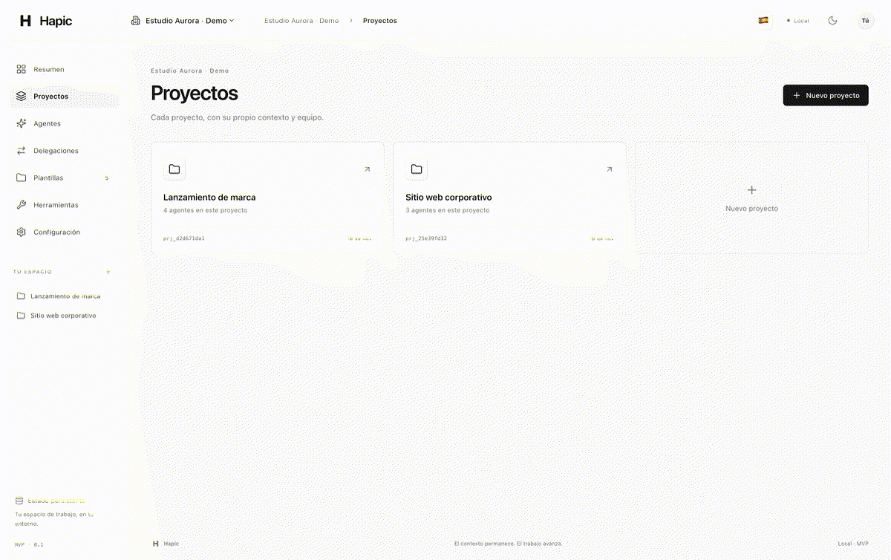
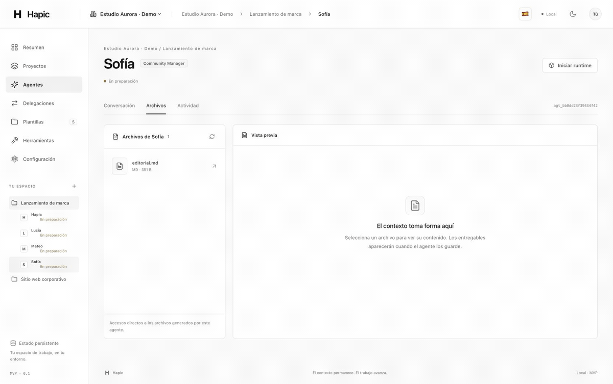
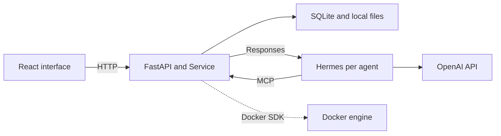

# Hapic

### Your way of working. An agent workflow to move it forward.

Hapic's purpose is to **create personalized agent workflows around your projects**: decide who owns each part, what context they need, which tools they use and what they hand over next. Turn ideas into work you can follow and review.

Templates are a starting point. The vision is for you to build your own team and the way it collaborates.

**[Explore the interactive demo →](https://esteban-rj.github.io/hapic/)** · [Get started locally](#get-started-locally) · [Español](README.md)



*Real interface in Spanish, sample data. [Static image](docs/media/equipo.jpg) · [About these GIFs](docs/media/README.md).*

## One goal. Several agents. A result you can review.

Imagine launching a product: one teammate defines the experience, another prepares visuals and another organizes content. Hapic brings that division of work to a team of agents with their own context, memory and files.

| What you need | What Hapic provides |
| --- | --- |
| Keep work moving across sessions | Persistent agents with memory and saved files. |
| Assign responsibilities | Profiles with defined roles, required context and deliverables. |
| Connect the team's work | Direct delegation within a project and a panel to track it. |
| Find what was produced | Access to briefs, plans, code, images and calendars from each agent. |
| Bring data into decisions | Read-only YouTube access, assignable to the agents you choose. |

## Workflows you can build with today's team

These sequences show how to divide the work. You review each result.

| Your goal | A possible sequence | Deliverables |
| --- | --- | --- |
| Launch a brand | UX → Graphic design → Community Manager | Brief, visuals and editorial calendar. |
| Build a website | Architect / Planner → Coder | Shared plan, implementation and tests in files. |
| Prepare content with context | YouTube → Community Manager → Graphic design | Authorized channel analysis, content proposals and requested visuals. |

Agents can delegate directly and retrieve the result. **Delegations** shows participants, context, responses and errors. Each agent keeps its own memory and workspace; required context is included in the task.

**Today:** choose agents from five templates, organize your project team and use its delegations and tools. Arrows describe a work sequence: the sender retrieves the result and does not automatically continue.

**Where Hapic is heading:** agents created from scratch with custom roles, instructions and tools, and more flexible personalized workflow composition. A visual workflow editor and creating agents from scratch are not implemented yet.

## From your team's work to your deliverables

Open an agent's **Files** tab and review its results. An architect's shared plan can guide its linked coder; documents and images remain saved for the next session.



*Spanish interface and sample documents prepared for the capture; these are not AI execution results. [Static image](docs/media/entregables.jpg).*

## Templates help you get started

Start with a prepared method and choose the specialists your project needs.

| Starting point | Can help with |
| --- | --- |
| UX | Briefs, flows, wireframes and accessibility. |
| Graphic design | Visual direction and PNG image generation. |
| Architect / Planner | Architecture, contracts and a shared implementation plan. |
| Coder | Code and tests in files, following its architect's plan. |
| Community Manager | Strategy, calendars, copy, scripts and metrics analysis. |

[Explore the screens →](docs/dashboard.md) · [Connect YouTube →](docs/youtube.md)

## Get started locally

**Explore first:** the [interactive demo](https://esteban-rj.github.io/hapic/) needs no installation, credentials or AI calls. It supports Spanish and English, light and dark themes, and pause controls.

**Then run it locally:** with Git and Docker Desktop's Linux engine running, on macOS or Linux:

```bash
git clone https://github.com/esteban-rj/hapic.git
cd hapic
./scripts/start-docker.sh
```

On Windows, from the repository:

```powershell
.\scripts\start-docker.ps1
```

Open [Hapic locally](http://127.0.0.1:8000). The first start downloads and builds the required images. [Native installation with Python, Node and pnpm](docs/guide.md) is also available.

1. **Provide context.** Create an organization and a project.
2. **Prepare the connection.** Save your OpenAI API key in **Settings** and start Docker.
3. **Build your team.** Create specialists through Hapic or **Templates**. A coder requires an architect in the same project.
4. **Start and assign.** Follow runtime preparation and chat when ready. State the goal, context and expected result.
5. **Track and review.** Check **Delegations**, open **Files** and decide the next step.

You can organize projects and prepare profiles without OpenAI or Docker. Chat and delegation execution require an API key and the recipient's runtime, and may incur API usage. Images may also incur costs.

In **Conversation**, choose **Automatic** and send a message to enable it for that agent. Hapic picks the model and reasoning effort for each request, including delegated work. You can also make it the default for new agents in **Settings**. [How automatic mode works](docs/guide.md#automatic-model-selection)

With **LiteLLM**, the selector shows only authorized models. **Best model** is the default when the Auto Router is available. Open the dashboard from **Settings → LiteLLM** to manage models and review spend, tokens, and requests. [Set up LiteLLM](docs/guide.md#litellm-models-and-spend)

The recipient’s chat shows when it is handling a delegation. If execution fails, **Delegations** shows the cause detected by Hapic. [Track delegations](docs/guide.md#delegaciones-entre-agentes)

## Available and planned

| Available in this local MVP | Planned |
| --- | --- |
| Projects, persistent agents and five templates | Agents from scratch with custom roles and instructions |
| Direct delegation and tracking panel | More flexible personalized workflow composition |
| Shared architect-to-coder plan | Connections such as HeyGen and ElevenLabs |
| File previews and persistent images | Social publishing and scheduling |
| Read-only YouTube | Remote multi-user access and enterprise roles |
| Spanish and English UI and new responses | |

The coder writes code and tests but has no terminal to run them. YouTube requires server-side OAuth configuration and channel authorization; it cannot publish or reply to comments. [Full scope](docs/guide.md#pruebas-y-alcance-verificado).

<details>
<summary><strong>Where are my data stored and what is sent to the model?</strong></summary>

Platform state, profiles, memories and workspaces are stored locally. Messages and the context needed for each turn are sent to OpenAI. Agents have separate profiles and workspaces; shared plans use authorized tools. [Persistence and access boundaries](docs/guide.md#persistencia-y-límites-de-acceso).

</details>

<details>
<summary><strong>Can I run this as a public service?</strong></summary>

This version is intended for one local operator. The control plane manages Docker; a public service requires multi-user authentication and additional hardening. [Trust and scope](docs/architecture.md#confianza-y-alcance).

</details>

## Technical documentation

Hapic uses **React/Vite + FastAPI + SQLite + one Hermes container per agent**. The platform manages work and tool access; each Hermes executes its agent's turns. Detailed guides are primarily in Spanish.



| I want to… | Guide |
| --- | --- |
| Understand component communication, containers and storage | [Current architecture maps](docs/architecture.md#mapas-de-la-arquitectura-actual) |
| Install, choose models and follow the complete walkthrough | [Usage and reference](docs/guide.md) |
| Start, update, back up or diagnose | [Local operations](docs/operations.md) |
| Integrate routes, sessions and tools | [API and MCP](docs/api.md) |
| Authorize a channel and assign it to agents | [YouTube](docs/youtube.md) |
| Check the social profile's scope | [Community Manager](docs/community-manager.md) |
| Check version changes | [Changelog](CHANGELOG.md) |

For contributors: [validation](docs/guide.md#pruebas-y-alcance-verificado), [execution skill](.agents/skills/hapic-execution/SKILL.md), [documentation skill](.agents/skills/hapic-feature-docs/SKILL.md) and [original mockups](docs/mockups).
