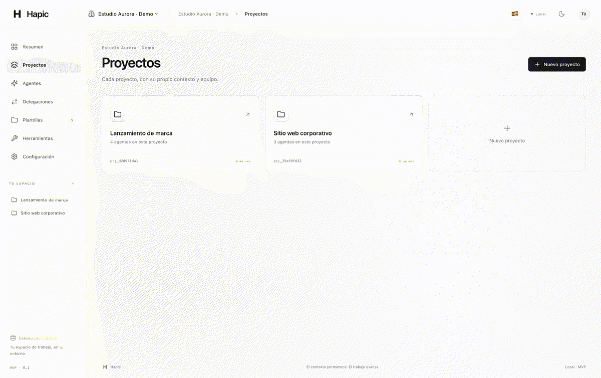
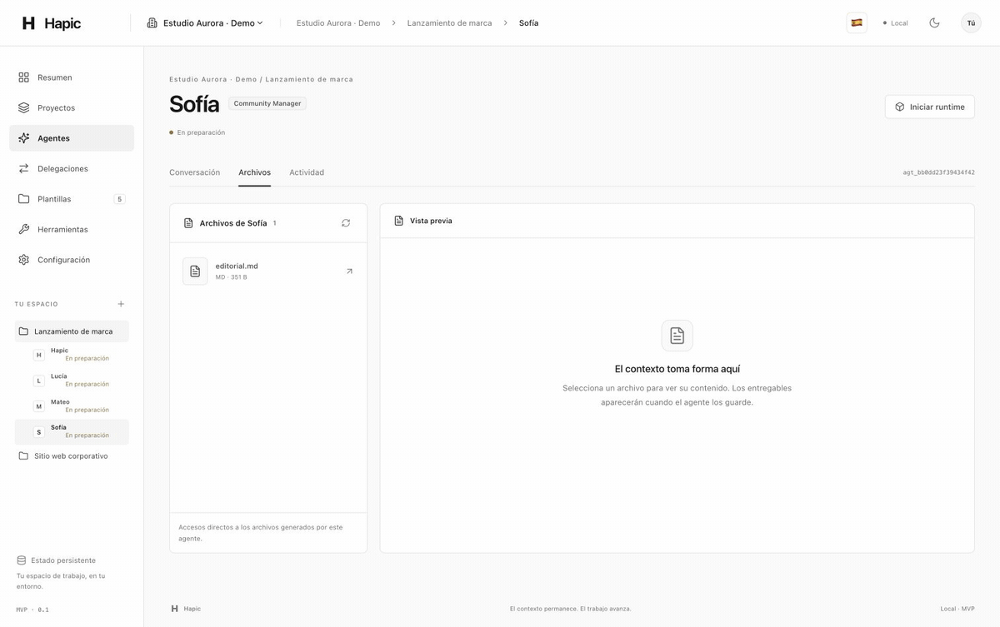
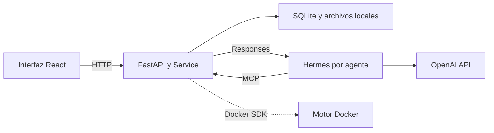

# Hapic

### Tu forma de trabajar. Un flujo de agentes para hacerla avanzar.

Hapic nace para **crear flujos de agentes personalizados alrededor de tus proyectos**: decidir quién se ocupa de cada parte, qué contexto necesita, qué herramientas utiliza y qué entrega al siguiente. Un espacio donde las ideas se convierten en trabajo que puedes seguir y revisar.

Las plantillas son el punto de partida. La visión es que construyas tu propio equipo y su forma de colaborar.

**[Explora la demo interactiva →](https://esteban-rj.github.io/hapic/)** · [Empieza en tu equipo](#empieza-en-tu-equipo) · [English](README.en.md)



*Interfaz real, datos de ejemplo. [Ver imagen estática](docs/media/equipo.jpg) · [Qué muestran los GIFs](docs/media/README.md).*

## Un objetivo. Varios agentes. Un resultado que puedes revisar.

Imagina el lanzamiento de tu producto: una persona define la experiencia, otra prepara las piezas visuales y otra organiza el contenido. Hapic lleva esa forma de repartir el trabajo a un equipo de agentes con contexto, memoria y archivos propios.

| Lo que necesitas | Lo que aporta Hapic |
| --- | --- |
| Dar continuidad al trabajo | Agentes persistentes que conservan memoria y archivos entre sesiones. |
| Repartir responsabilidades | Perfiles con funciones, contexto requerido y entregables definidos. |
| Conectar el trabajo del equipo | Delegación directa entre agentes del mismo proyecto y un panel para seguirla. |
| Encontrar lo que se produjo | Accesos a briefs, planes, código, imágenes y calendarios desde cada agente. |
| Aportar datos a las decisiones | YouTube de solo lectura, asignable a los agentes que elijas. |

## Flujos que puedes construir con el equipo actual

Estas secuencias muestran cómo repartir el trabajo; cada resultado pasa por tu revisión.

| Tu objetivo | Un posible recorrido | Entregables |
| --- | --- | --- |
| Lanzar una marca | UX → Diseño gráfico → Community Manager | Brief, piezas visuales y calendario editorial. |
| Construir un sitio web | Arquitecto / Planner → Coder | Plan compartido, implementación y pruebas en archivos. |
| Preparar contenido con contexto | YouTube → Community Manager → Diseño gráfico | Análisis del canal autorizado, propuestas de contenido y piezas solicitadas. |

Los agentes pueden delegar tareas directamente y consultar su resultado. **Delegaciones** permite ver participantes, contexto, respuestas y errores. Los archivos y memorias de cada agente siguen siendo propios; el contexto necesario se incluye en la tarea.

**Hoy:** eliges agentes de cinco plantillas, organizas el equipo por proyecto y utilizas sus delegaciones y herramientas. Las flechas describen una secuencia de trabajo: el remitente consulta el resultado y no continúa automáticamente.

**Hacia dónde va Hapic:** agentes creados desde cero con rol, instrucciones y herramientas propios, y una composición más flexible de flujos personalizados. El editor visual de flujos y esa creación desde cero aún no están implementados.

## Del trabajo de tu equipo a tus entregables

Abre un agente, entra en **Archivos** y revisa sus resultados. El plan del arquitecto puede alimentar al coder vinculado; los documentos e imágenes quedan guardados para continuar después.



*Documentos de ejemplo preparados para la captura; no son resultados de una ejecución de IA. [Ver imagen estática](docs/media/entregables.jpg).*

## Las plantillas te ayudan a empezar

Parte de un método preparado y elige qué especialistas necesita tu proyecto.

| Punto de partida | Puede ayudarte con |
| --- | --- |
| UX | Briefs, flujos, wireframes y accesibilidad. |
| Diseño gráfico | Dirección visual y generación de imágenes PNG. |
| Arquitecto / Planner | Arquitectura, contratos y plan compartido para implementación. |
| Coder | Código y pruebas en archivos, siguiendo el plan de su arquitecto. |
| Community Manager | Estrategia, calendarios, copys, guiones y análisis de métricas. |

[Explora los perfiles y las pantallas →](docs/dashboard.md) · [Conecta YouTube →](docs/youtube.md)

## Empieza en tu equipo

**Primero explora:** la [demo interactiva](https://esteban-rj.github.io/hapic/) funciona sin instalar nada, sin credenciales y sin llamadas a IA. Tiene español e inglés, temas claro y oscuro y controles de pausa.

**Después úsalo localmente:** con Git y Docker Desktop con motor Linux activos, en macOS o Linux:

```bash
git clone https://github.com/esteban-rj/hapic.git
cd hapic
./scripts/start-docker.sh
```

En Windows, desde el repositorio:

```powershell
.\scripts\start-docker.ps1
```

Abre [Hapic en tu equipo](http://127.0.0.1:8000). El primer inicio descarga y construye las imágenes necesarias. También puedes [instalarlo con Python, Node y pnpm](docs/guide.md).

### Recorrido

1. **Dale contexto.** Crea una organización y un proyecto.
2. **Prepara la conexión.** Guarda tu API key de OpenAI en **Configuración** e inicia Docker.
3. **Reúne tu equipo.** Crea los especialistas desde Hapic o desde **Plantillas**. Para un coder, selecciona primero un arquitecto del mismo proyecto.
4. **Inicia y encarga.** Sigue la preparación del runtime y conversa cuando esté disponible. Define objetivo, contexto y resultado esperado.
5. **Sigue y revisa.** Consulta **Delegaciones**, abre **Archivos** y decide el siguiente paso.

La plataforma permite organizar proyectos y preparar perfiles sin OpenAI ni Docker. Conversar y ejecutar delegaciones requieren una API key y el runtime del destinatario; pueden generar consumo de API. Las imágenes también pueden tener coste.

En **Conversación**, elige **Automático** y envía un mensaje para activarlo en ese agente. Hapic elige el modelo y el nivel de razonamiento según cada encargo, incluidas las delegaciones. También puedes configurarlo como opción predeterminada para agentes nuevos. [Cómo funciona el modo automático](docs/guide.md#selección-automática-del-modelo)

Con **LiteLLM**, el selector muestra únicamente los modelos autorizados. **Best model** es el predeterminado cuando el Auto Router está disponible. Desde **Configuración → LiteLLM** puedes abrir el panel para gestionar modelos y consultar costes, tokens y solicitudes. [Configurar LiteLLM](docs/guide.md#litellm-modelos-y-costes)

En el chat de un destinatario puedes ver cuándo está atendiendo una delegación. Si la ejecución falla, **Delegaciones** muestra la causa que detectó Hapic. [Seguir delegaciones](docs/guide.md#delegaciones-entre-agentes)

## Lo disponible y lo que viene

| Disponible en este MVP local | Previsto |
| --- | --- |
| Proyectos, agentes persistentes y cinco plantillas | Agentes creados desde cero con rol e instrucciones propios |
| Delegación directa y panel de seguimiento | Composición más flexible de flujos personalizados |
| Plan compartido de arquitecto a coder | Nuevas conexiones como HeyGen y ElevenLabs |
| Archivos con vista previa e imágenes persistentes | Publicación y programación social |
| YouTube de solo lectura | Acceso remoto multiusuario y roles empresariales |
| Interfaz y nuevas respuestas en español e inglés | |

El coder escribe código y pruebas; no tiene terminal para ejecutarlas. YouTube requiere configuración OAuth del servidor y autorización del canal; no publica ni responde comentarios. [Consulta el alcance completo](docs/guide.md#pruebas-y-alcance-verificado).

<details>
<summary><strong>¿Dónde quedan mis datos y qué se envía al modelo?</strong></summary>

El estado de Hapic, los perfiles, memorias y workspaces se guardan localmente. Los mensajes y el contexto necesario para cada turno se envían a OpenAI. Cada agente tiene su propio perfil y workspace; los planes compartidos se leen mediante herramientas autorizadas. [Persistencia y límites de acceso](docs/guide.md#persistencia-y-límites-de-acceso).

</details>

<details>
<summary><strong>¿Puedo usarlo como un servicio público?</strong></summary>

Esta versión está pensada para un operador local. El control de gestión administra Docker; un servicio público requiere autenticación multiusuario y endurecimiento adicional. [Confianza y alcance](docs/architecture.md#confianza-y-alcance).

</details>

## Documentación técnica

Hapic utiliza **React/Vite + FastAPI + SQLite + un contenedor Hermes por agente**. La plataforma gestiona el trabajo y el acceso a herramientas; cada Hermes ejecuta los turnos de su agente.



| Quiero… | Guía |
| --- | --- |
| Entender cómo se comunican los componentes y contenedores | [Mapas de la arquitectura actual](docs/architecture.md#mapas-de-la-arquitectura-actual) |
| Instalar, elegir modelos y conocer el recorrido completo | [Guía de uso y referencia](docs/guide.md) |
| Arrancar, actualizar, respaldar o diagnosticar | [Operación local](docs/operations.md) |
| Integrar rutas, sesión y herramientas | [API y MCP](docs/api.md) |
| Autorizar un canal y asignarlo a los agentes | [YouTube](docs/youtube.md) |
| Consultar el alcance del perfil social | [Community Manager](docs/community-manager.md) |
| Ver cambios entre versiones | [Changelog](CHANGELOG.md) |

Para contribuir: [pruebas y validación](docs/guide.md#pruebas-y-alcance-verificado), [skill de ejecución](.agents/skills/hapic-execution/SKILL.md) y [skill de documentación](.agents/skills/hapic-feature-docs/SKILL.md). Los [bocetos iniciales](docs/mockups) conservan la evolución visual del proyecto.
