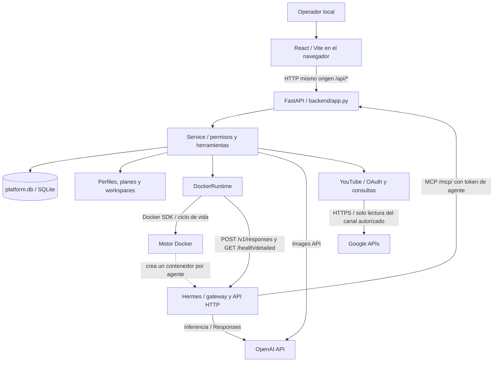
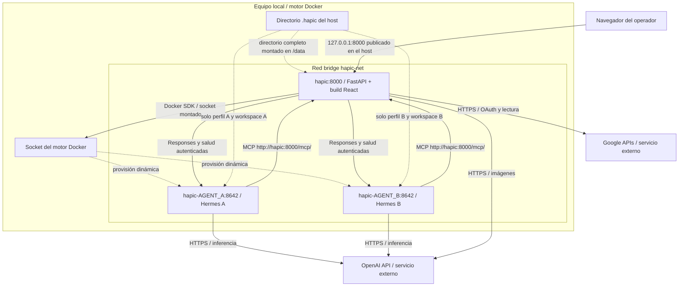
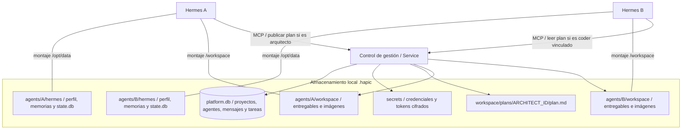
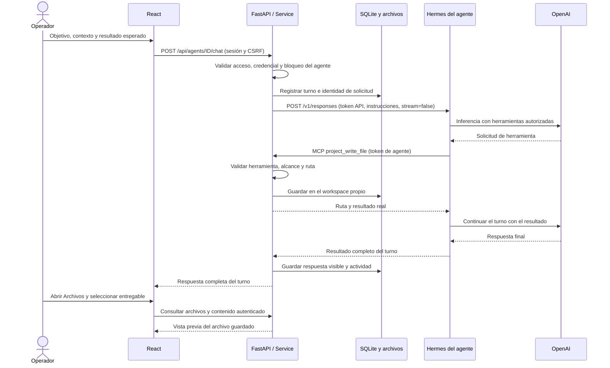
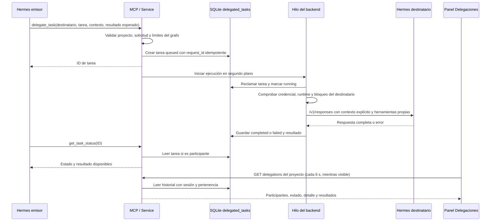

# Arquitectura

Hapic es un control de gestión local para agentes Hermes persistentes. La versión actual separa la interfaz, los metadatos de la plataforma y los procesos de los agentes. Esta es la base actual para la visión de flujos de agentes personalizados: hoy hay agentes creados desde plantillas, delegaciones directas y planes compartidos; no hay un editor visual ni un motor general de flujos.

[← Propuesta y casos de uso](../README.md) · [Guía de uso](guide.md) · [Operación](operations.md) · [API y MCP](api.md)

## Mapas de la arquitectura actual

Los mapas describen el código de este repositorio: `backend/app.py`, `backend/service.py`, `backend/runtime.py`, `backend/storage.py`, `compose.yaml` y `Dockerfile`. Las flechas indican solicitudes o acceso a datos, no pasos que se encadenen automáticamente.

### 1. Comunicación entre componentes

FastAPI sirve el frontend compilado y la API en el mismo origen. La UI no llama directamente a Hermes, al motor Docker ni a Google. La inferencia sale desde Hermes a OpenAI; la generación de imágenes sale desde el backend. Los tokens de API Hermes y MCP son distintos y propios de cada agente.

### 2. Contenedores, red y puertos con Compose

`compose.yaml` declara únicamente el servicio `hapic` y la red. Los agentes se crean dinámicamente con Docker SDK, desde `nousresearch/hermes-agent:stable` o la imagen configurada; no son servicios declarados en Compose ni contenedores anidados dentro de Hapic. Son contenedores hermanos en el mismo motor.

| Elemento | Compose | Arranque nativo |
| --- | --- | --- |
| Control de gestión | Contenedor `hapic`, puerto interno 8000 | Proceso Python en el host, puerto 8000 |
| Entrada del navegador | `127.0.0.1:8000` | `127.0.0.1:8000` |
| API de cada Hermes | Nombre del contenedor en `hapic-net`, puerto 8642; sin publicación en el host | Puerto aleatorio publicado solo en `127.0.0.1`, dirigido al 8642 del agente |
| Retorno MCP desde Hermes | `http://hapic:8000/mcp/` | `http://host.docker.internal:8000/mcp/` |
| Acceso al motor | Socket montado en el control de gestión | Endpoint del contexto Docker activo, resuelto por el lanzador |
| Datos de plataforma | Directorio del host montado en `/data` | `HAPIC_DATA_DIR` en el host |

Solo el control de gestión recibe acceso al motor. Cada agente recibe dos montajes de datos, `/opt/data` y `/workspace`, y sus credenciales de ejecución; no recibe el socket ni todo el directorio del proyecto. El motor y el administrador del host son parte del perímetro de confianza.

### 3. Persistencia y límites entre agentes

El plan del arquitecto se comparte mediante herramientas autorizadas; no se monta como una carpeta compartida en todos los agentes. La escritura del coder comprueba que haya leído la revisión actual. Delegar transmite el contexto explícito de la tarea, sin abrir automáticamente la memoria ni el workspace del destinatario. El estado se guarda localmente, mientras que la inferencia transmite a OpenAI los mensajes y el contexto necesario.

### 4. De la conversación a un archivo

El diagrama representa un turno que utiliza escritura de archivos; no todos los turnos la necesitan. El chat espera la respuesta completa, sin streaming de tokens. Un adjunto de imagen puede persistir aunque falle la respuesta final de Hermes.

### 5. Delegación directa, mediada por la plataforma

No hay conexión HTTP directa entre contenedores de agentes ni una inferencia adicional del orquestador para mediar la tarea. La consulta del emisor puede devolver una tarea aún pendiente. El backend no reanuda automáticamente al emisor ni reintenta tareas. `completed` confirma que terminó el turno; su respuesta puede indicar trabajo parcial o bloqueado. Se validan permisos y límites estructurales; los requisitos semánticos del contrato son instrucciones para los agentes, no un esquema validado por el backend.

En el arranque de la plataforma, las delegaciones interrumpidas quedan fallidas. El worker actual es un hilo en el proceso del backend, no una cola externa ni un motor durable de workflows.

## Componentes

| Componente | Responsabilidad | Código |
| --- | --- | --- |
| Interfaz | Onboarding, navegación, chat, archivos y ajustes | `frontend/src/` |
| API | Sesión local, validación, rutas HTTP y servidor MCP | `backend/app.py` |
| Servicio | Organizaciones, proyectos, perfiles, permisos y herramientas | `backend/service.py` |
| Almacenamiento | SQLite, rutas persistentes, cifrado y tokens | `backend/storage.py` |
| Runtime | Configuración Hermes, contenedores, readiness y chat | `backend/runtime.py` |
| Preparación | Etapas, tiempos, registros seguros e intentos persistentes | `backend/preparation.py` |
| Plantillas | Comportamiento y método revisables, sin estado privado | `templates/` |
| Herramientas | Catálogo de integraciones y permisos efectivos por agente | `backend/tool_catalog.py` |
| YouTube | OAuth de Google, tokens cifrados y consultas limitadas al canal asignado | `backend/youtube.py` |

FastAPI sirve el build de Vite en producción. En desarrollo, Vite reenvía `/api` al backend. El chat actual espera una respuesta completa del servidor; la interfaz no implementa streaming de tokens.

## Modelo de datos

Una organización agrupa proyectos. Cada proyecto tiene un orquestador Hapic y especialistas UX, diseño gráfico, arquitectura/planning, código o community management. La tabla `memberships` relaciona al operador local con las organizaciones y se comprueba al acceder a proyectos o agentes. El [catálogo de herramientas](youtube.md) permite asignar YouTube de solo lectura a cualquier agente; Community Manager lo incluye inicialmente. Los canales OAuth pertenecen al proyecto y las credenciales permanecen en el servidor.

`platform.db` contiene organizaciones, pertenencias, proyectos, agentes, mensajes visibles, imágenes, actividad, ajustes y sesiones locales. `agents.planner_id` vincula un coder al arquitecto. El estado de Hermes vive en otro SQLite dentro de su propio perfil. La inicialización crea tablas e índices y añade `planner_id` a instalaciones previas sin borrar datos; no incluye un framework general de migraciones.

Los identificadores generados se usan como nombres de carpetas. Los nombres elegidos por el usuario se conservan en metadatos y no se interpretan como rutas.

## Creación y ejecución de agentes

1. Crear un proyecto materializa sus metadatos, carpetas y un perfil Hapic nuevo. Si hay una key configurada, se solicita su provisión.
2. Hapic consulta el catálogo de templates y pregunta el nombre cuando falte. La interfaz también permite crear perfiles desde un formulario.
3. La herramienta MCP `create_specialist_agent` valida el alcance del token y crea un perfil limpio; `create_ux_agent` se conserva por compatibilidad.
4. El servicio solicita la provisión en segundo plano y registra el avance. Crear el perfil o encolar el trabajo no garantiza que el contenedor esté disponible.
5. El provisionador descarga la imagen si hace falta, monta únicamente el home y el workspace del agente e inicia `gateway run`.
6. El runtime solo queda disponible cuando `/health/detailed` responde autenticado con `status: ok`.

| Estado | Significado |
| --- | --- |
| `pending` | Perfil preparado; arranque pendiente |
| `provisioning` | Provisión en curso |
| `running` | Última provisión completada con readiness comprobado |
| `blocked` | Falta un requisito o el runtime no pudo quedar listo |
| `error` | Falló la provisión y se registró un mensaje seguro |

La consulta de runtime puede devolver además `starting`, `stopped` o `unavailable` según su comprobación actual. La tabla de agentes muestra el estado registrado y el detalle consulta la API real. La disponibilidad de Hermes no verifica por sí sola el acceso al modelo de OpenAI: eso se comprueba al ejecutar un turno.

### Flujo persistente de preparación

`agent_preparations` conserva los intentos de arranque y `preparation_steps` sus siete etapas: perfil, requisitos, configuración, red, imagen, contenedor y readiness. El servicio registra la materialización del perfil y el runtime registra los hitos reales de Docker. Una imagen en caché completa su etapa sin simular descarga. El contenedor anterior se reemplaza después de preparar la red y la imagen. Cada etapa conserva estado, fechas y registros controlados por Hapic; no se almacena stdout del contenedor ni excepciones crudas. Los fallos conservan las etapas posteriores pendientes. Un reintento crea otro registro y reutiliza el perfil persistente.

El endpoint de preparación verifica sesión y pertenencia; no consulta Docker ni realiza inferencia. Durante la preparación, Conversación muestra el último intento como nodos conectados, pendientes y registros por etapa, con navegación por teclado, temas claro/oscuro y disposición vertical en móvil. El título incluye el nombre del agente. El chat se monta únicamente con estado registrado `running`, readiness real y credencial configurada; reemplaza al flujo cuando se cumplen esas condiciones. Los runtimes detenidos o sin comprobación muestran su estado sin chat; un error al consultar el detalle invalida la disponibilidad anterior. Archivos y Actividad se mantienen accesibles. Selección y detalle se actualizan cada tres segundos mientras la pestaña está visible; las peticiones de detalle se cancelan al cambiar de agente o idioma. El estado de provisión tiene prioridad sobre la salud del contenedor anterior. Reiniciar la plataforma marca intentos interrumpidos como bloqueados y permite reintentar. Los perfiles previos sin registro devuelven `null`, sin inventar etapas históricas.

## Modelos y conversaciones

El valor inicial es `gpt-6.1-sol` con `xhigh`. Los ajustes globales se aplican a perfiles nuevos; el compositor permite cambiar el modelo y esfuerzo de un agente existente para su siguiente turno.

La configuración de Hermes fija `provider: openai-api`, `api_mode: codex_responses` y el endpoint oficial de OpenAI. El cliente del control de gestión utiliza `/v1/responses`, selección explícita de proveedor/modelo y `model_options.reasoning_effort`. No utiliza ni importa OAuth de Codex.

Cada conversación usa una identidad estable del agente. `Idempotency-Key` protege las solicitudes hacia Hermes y la plataforma registra la identidad del turno para evitar duplicar mensajes al repetir una solicitud con el mismo identificador.

## Persistencia y aislamiento

Cada agente tiene un `HERMES_HOME` montado en `/opt/data` y un workspace distinto montado en `/workspace`. Los documentos de UX se leen y escriben mediante herramientas MCP autorizadas en el workspace de ese agente.

Las carpetas organizan el estado. La autorización de la API, los tokens por agente, las herramientas permitidas y los montajes Docker controlan el acceso. Las instrucciones del modelo no sustituyen esos controles.

Las plantillas contienen `SOUL.md`, definición y habilidades. Al crear un perfil se inicializa memoria vacía; nunca se clonan `state.db`, credenciales o recuerdos privados de un agente usado.

### Planes compartidos

El arquitecto publica en `workspace/plans/<architect-id>/plan.md` del proyecto. Los coders vinculados lo leen mediante la herramienta dedicada; no se monta todo el proyecto en sus contenedores. Antes de escribir, el servidor comprueba que el coder haya leído la revisión SHA-256 actual. Cada coder conserva un workspace separado. Escriben código y pruebas, sin terminal ni ejecución automática.

### Imágenes

`backend/images.py` llama a `/v1/images/generations` con la credencial del servidor. Decodifica base64 y valida PNG y tamaño. La herramienta escribe atómicamente en el workspace antes de registrar un mensaje de archivo y una fila `images`. Ese mensaje se conserva si después falla Hermes. La UI carga los bytes desde una ruta autenticada del mismo origen y permite descargar; no guarda base64 en SQLite ni solicita URLs arbitrarias del proveedor.

Las instrucciones de integración actualizadas se envían en `instructions` de cada petición Responses, sin sobrescribir el `SOUL.md` ni memorias existentes. La lista de herramientas de un runtime existente se actualiza al recrearlo.

## Confianza y alcance

El MVP permite un operador local. La sesión no es un sistema de cuentas remoto y no ofrece aislamiento frente al administrador del equipo. El control de gestión puede administrar el motor Docker; los agentes no reciben su socket.

La key del formulario se cifra con una clave maestra local. Los procesos y contenedores que realizan inferencia necesitan la credencial en su entorno. Un administrador de Docker o del equipo puede acceder a ese entorno.

El estado se guarda localmente. Los mensajes y el contexto necesario para cada turno se transmiten a OpenAI. Consulta [operación](operations.md) para copias de seguridad, rotación y recuperación.

## Colaboración directa entre agentes

Cada turno de Hermes recibe en sus instrucciones un roster actualizado del mismo proyecto: ID, nombre, rol, descripción, capacidades, entregables, contrato de delegación, vínculo de planner y estado registrado. Se consulta SQLite al construir el turno; los perfiles existentes reciben esta conciencia sin copiar recuerdos privados. `list_project_agents` permite actualizar la consulta durante el turno. El estado registrado no garantiza readiness del runtime.

Todos los perfiles tienen `delegate_task` y `get_task_status`. El emisor elige directamente al destinatario; el backend ejecuta el turno en el Hermes de ese destinatario, con sus propias herramientas y permisos. No interviene el modelo del orquestador. La tarea incluye contexto explícito y entregables esperados; no comparte automáticamente archivos ni memoria. Los resultados se recuperan consultando `get_task_status`; no se inicia automáticamente otro turno facturable del emisor.

Las delegaciones se guardan en `delegated_tasks` con emisor, destinatario, solicitud idempotente, padre, estado, resultado y fechas. Solo los participantes pueden consultarlas mediante MCP. El backend rechaza autodelegación, otros proyectos, ciclos entre delegaciones activas y cadenas de más de cuatro niveles. Los turnos usan el mismo bloqueo que el chat y la provisión. Un destinatario ocupado, sin credencial o sin runtime produce una tarea fallida; no hay reintento automático. Tras reiniciar la plataforma, las tareas interrumpidas quedan fallidas para evitar repetir acciones con efectos externos sin revisión.

Después de actualizar Hapic, reinicia los contenedores existentes desde **Iniciar runtime** para regenerar su configuración con las nuevas herramientas MCP. Los agentes nuevos ya las incluyen.

### Contratos e instrucciones de colaboración

Los seis perfiles, incluido Hapic, definen `delegation_contract` en su `template.json`. El catálogo de especialistas y el roster usan la misma fuente; Hapic mantiene su perfil propio sin aparecer como una plantilla de especialista creable.

| Campo | Uso por el colega que delega |
| --- | --- |
| `owns` | Identificar el trabajo y las decisiones que corresponden al destinatario. |
| `delegate_when` | Reconocer situaciones en las que conviene llamar a ese destinatario. |
| `required_inputs` | Preparar el contexto necesario para empezar. |
| `returns` | Establecer el entregable y sus criterios de aceptación. |
| `limitations` | Considerar dependencias, permisos y acciones que el perfil no puede realizar. |

`agent_instructions` combina el `SOUL.md` vigente del rol, las reglas comunes de `templates/delegation.md` y el contrato propio. Se utiliza al crear un perfil y en cada petición a Hermes. Así los agentes existentes reciben las nuevas instrucciones en su próximo turno sin reescribir su home ni sus recuerdos. Una vez disponibles las herramientas de colaboración, cambiar contratos o instrucciones requiere actualizar el backend y las plantillas, sin recrear contenedores.

El destinatario usa el contexto del remitente y devuelve las preguntas esenciales en el resultado si no puede avanzar. El coder solicita planes o revisiones directamente a su arquitecto vinculado; si este es el remitente de una tarea activa, devuelve el bloqueo para evitar un ciclo. El Community Manager puede delegar imágenes solicitadas al diseñador. Las delegaciones no autorizan acciones adicionales fuera del alcance de la solicitud.

La respuesta final incluye estado del trabajo, contenido utilizable, artefactos reales, validación y pendientes para el remitente. Debe incluir el texto, código o decisiones necesarios para continuar, porque las rutas de otro workspace no conceden acceso. Las imágenes se describen y referencian mediante agent_id, ruta e identificador real; no se inventan adjuntos compartidos. Esta es una convención de instrucciones, no una validación semántica del backend: `delegated_tasks.status='completed'` significa que terminó el turno del runtime, y el contenido de `result` puede informar trabajo parcial o bloqueado.

### Panel de delegaciones

La navegación principal incluye **Delegaciones**, con selector de proyecto, contadores, filtros por estado y agente (emisor o destinatario), paginación y detalle de la solicitud y respuesta. El estado del runtime de un agente y el de una tarea tienen etiquetas distintas. El detalle permite abrir el chat de los participantes y copiar el resultado; una respuesta finalizada puede informar trabajo parcial o bloqueado.

Las rutas HTTP verifican sesión y pertenencia antes de leer `delegated_tasks`. La lista devuelve solo una vista resumida; el texto completo y los resultados se leen por ID y proyecto cuando se selecciona una tarea. Los contadores y la página se leen en una misma transacción para mantener una vista consistente. Un índice por proyecto, fecha e ID apoya el historial. La UI actualiza lista y detalle cada seis segundos, cancela peticiones al cambiar de vista y descarta respuestas de proyectos o filtros anteriores. Todo el panel funciona sobre SQLite sin depender de Docker ni de inferencia.
