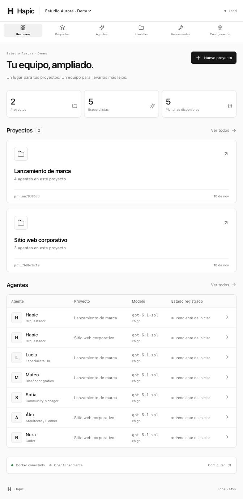
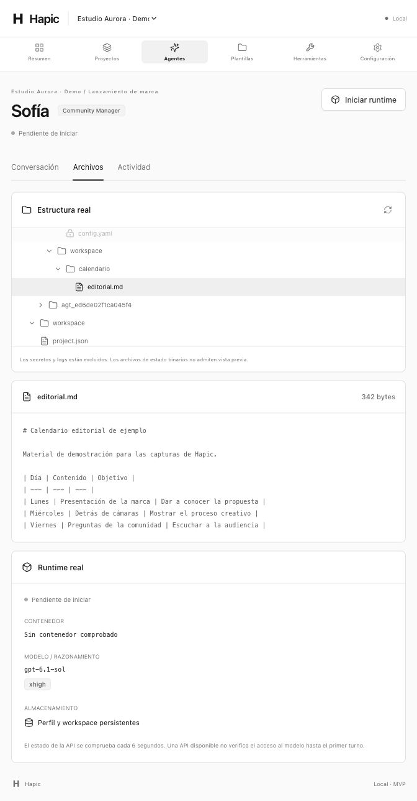
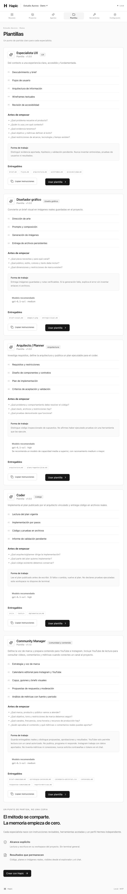
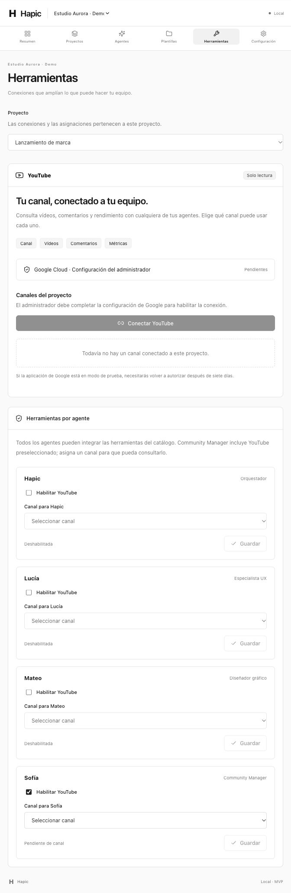

# Dashboard de Hapic

Capturas de la interfaz de este repositorio, tomadas el 10 de noviembre de 2026 en una ventana compacta del navegador. El diseño se adapta al ancho disponible.

La organización **Estudio Aurora · Demo**, sus dos proyectos y los archivos visibles son ejemplos creados en una instancia con almacenamiento independiente. Los agentes conservan su estado real **Pendiente de iniciar** y YouTube aparece pendiente de configuración y conexión.

## Resumen

La vista inicial reúne los proyectos de la organización, el número de especialistas, las plantillas disponibles y la tabla de agentes con su modelo y estado registrado.

## Archivos de un agente

El espacio del Community Manager permite explorar los archivos del proyecto, abrir un calendario editorial de ejemplo y consultar el estado de su runtime. El archivo mostrado se preparó para esta demostración.

## Plantillas de especialistas

El catálogo presenta las capacidades, preguntas iniciales, entregables y forma de trabajo de UX, diseño gráfico, arquitectura, código y community management.

Ver la captura completa del catálogo de plantillas

## Herramientas

Las conexiones pertenecen al proyecto seleccionado. La sección de herramientas muestra la configuración de YouTube y permite habilitarla por agente. En este ejemplo, Community Manager la tiene preseleccionada y queda pendiente de asignar un canal autorizado.

[Volver al README](../README.md) · [Configuración de YouTube](youtube.md) · [Arquitectura](architecture.md)
