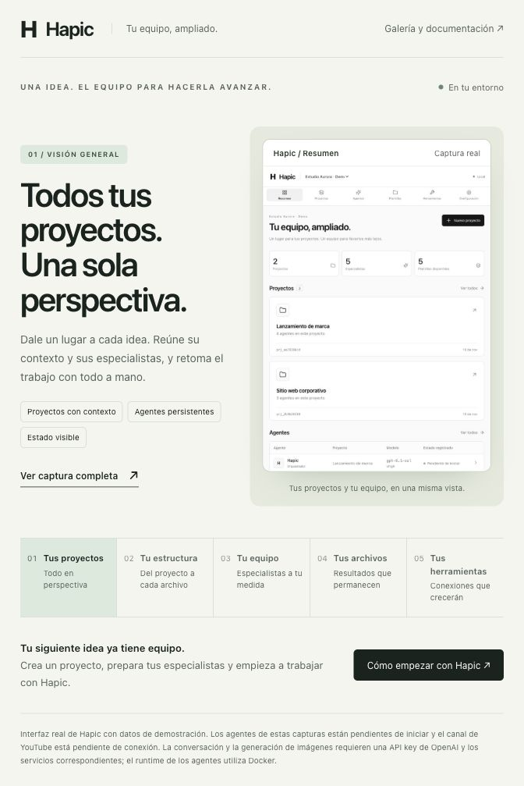
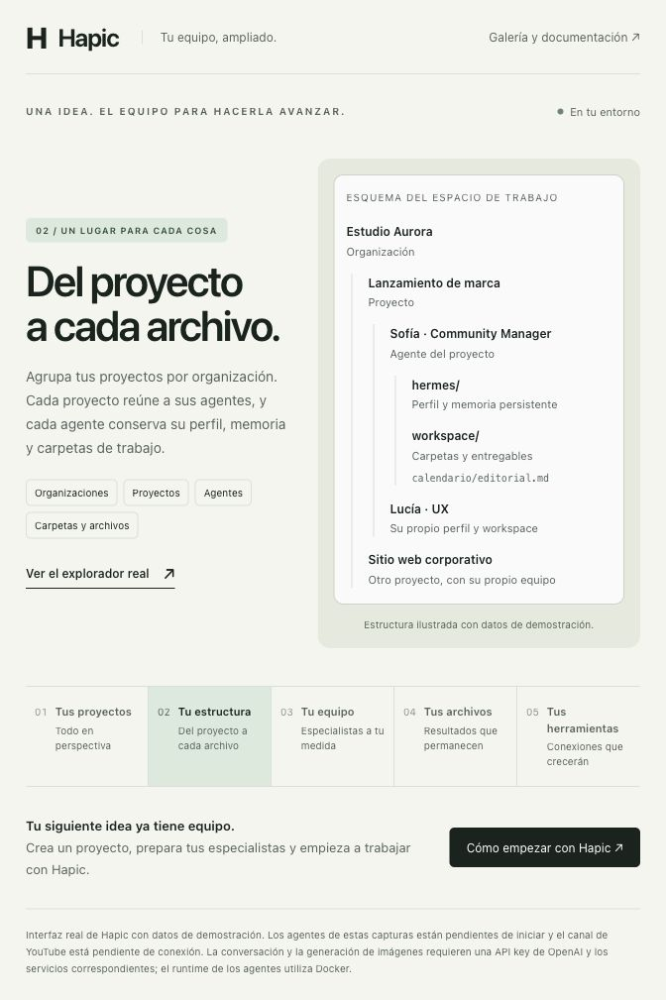
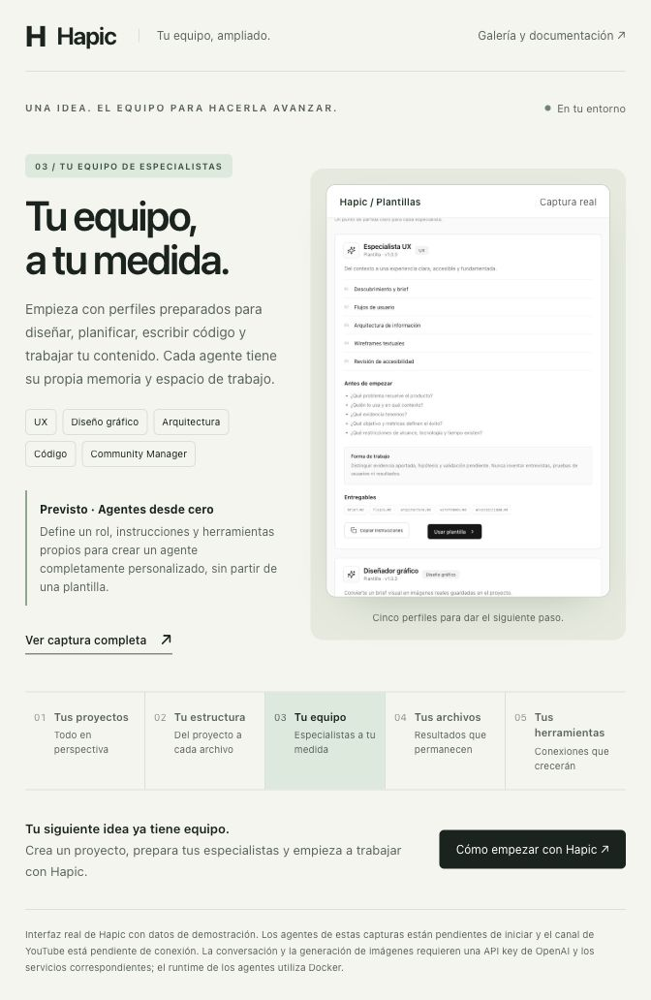
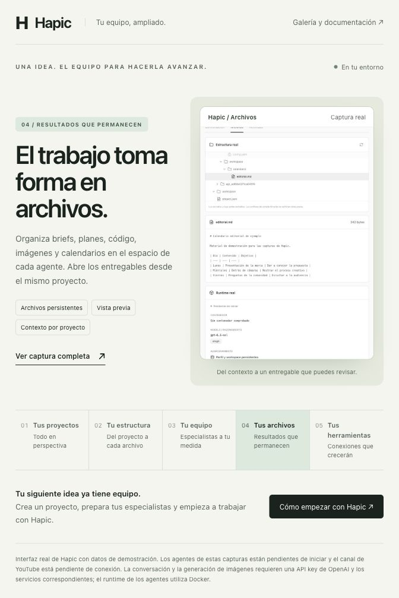
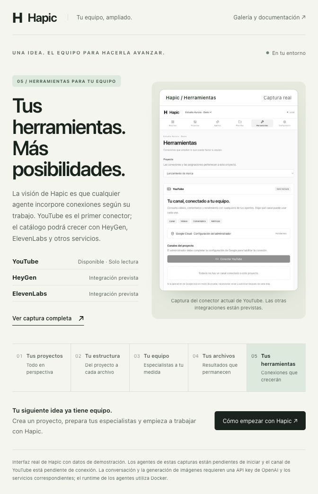

# Hapic · Tu siguiente idea ya tiene equipo

Un espacio para organizar tus proyectos y trabajar con especialistas de IA que conservan su memoria, sus archivos y un propósito definido.

[Abrir el recorrido visual →](https://esteban-rj.github.io/hapic/)

## Todos tus proyectos. Una sola perspectiva.

Dale un lugar a cada idea. Desde el resumen puedes explorar tus proyectos, encontrar a sus agentes y consultar el modelo y el estado de cada uno. Cuando vuelves al trabajo, el contexto sigue organizado por proyecto.



[Ver la captura original completa del resumen](screenshots/dashboard-resumen.jpg)

## Del proyecto a cada archivo.

La organización agrupa los proyectos. Cada proyecto reúne a sus agentes y un workspace compartido; cada agente dispone de un perfil Hermes con memoria y de su propio workspace para carpetas y archivos.

```text
.hapic/
  organizations/<organizacion-id>/
    projects/<proyecto-id>/
      workspace/                     # planes compartidos del proyecto
      agents/<agente-id>/
        hermes/                      # perfil, configuración y memoria
        workspace/                   # carpetas y archivos del agente
          calendario/editorial.md
```



## Un especialista para cada reto.

Construye tu equipo a partir de perfiles preparados. Cada plantilla define una forma de trabajo, preguntas iniciales y entregables para empezar con una dirección clara.

**Previsto: agentes desde cero.** La evolución del producto contempla definir un rol, instrucciones y herramientas propios para crear un agente completamente personalizado, sin plantilla. La versión actual de este repositorio crea agentes desde las plantillas disponibles.

| Lo que quieres construir | Tu especialista |
| --- | --- |
| Una experiencia clara y accesible | UX |
| Piezas visuales e imágenes | Diseñador gráfico |
| Una arquitectura y un plan de implementación | Arquitecto / Planner |
| Código y pruebas siguiendo ese plan | Coder |
| Estrategia, calendarios y contenido para tu comunidad | Community Manager |



<details>
<summary>Ver la captura completa del catálogo de plantillas</summary>


</details>

## El trabajo toma forma en archivos.

Briefs, planes, código, imágenes y calendarios tienen un espacio propio. Explora los archivos del proyecto y abre los entregables desde la misma interfaz. En esta pantalla, el Community Manager tiene un calendario editorial de ejemplo listo para revisar.



[Ver la captura original completa del explorador](screenshots/dashboard-archivos.jpg)

## Tus herramientas. Más posibilidades.

Conecta un canal autorizado de YouTube y elige qué agentes pueden consultar sus vídeos, comentarios y métricas. La herramienta pertenece al proyecto y puede integrarse en cualquiera de sus perfiles; Community Manager la incluye preseleccionada.

El catálogo podrá incorporar **HeyGen**, **ElevenLabs** y otros servicios. Son integraciones previstas; el conector disponible actualmente es YouTube de solo lectura.



[Ver la captura original completa de herramientas](screenshots/dashboard-herramientas.jpg)

## Prepara tu primer equipo.

Crea una organización, abre un proyecto y prepara los especialistas que necesitas. [Consulta cómo empezar con Hapic](../README.md#recorrido).

### Sobre estas capturas

Interfaz real de este repositorio, capturada el 10 de noviembre de 2026 en una ventana compacta del navegador. La organización **Estudio Aurora · Demo**, sus proyectos y los archivos visibles son ejemplos creados en almacenamiento independiente. Los agentes aparecen **Pendientes de iniciar** y YouTube está pendiente de configuración y conexión.

YouTube es de solo lectura; la publicación y la delegación automática entre agentes siguen pendientes. El Coder entrega código y pruebas en archivos. La conversación requiere configurar OpenAI e iniciar el runtime Docker del agente.

[Recorrido visual](https://esteban-rj.github.io/hapic/) · [README](../README.md) · [Configuración de YouTube](youtube.md) · [Arquitectura](architecture.md)
