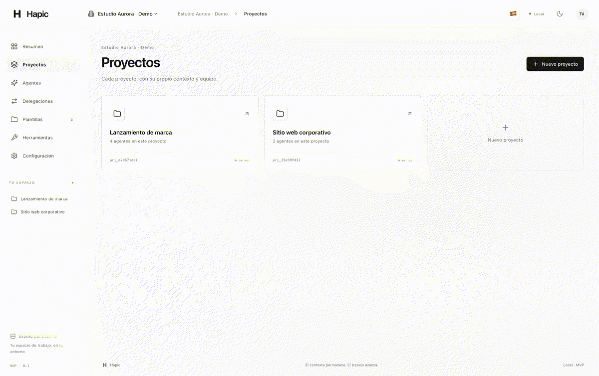
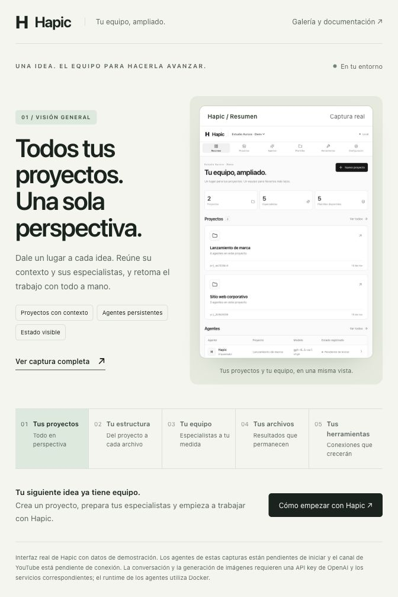
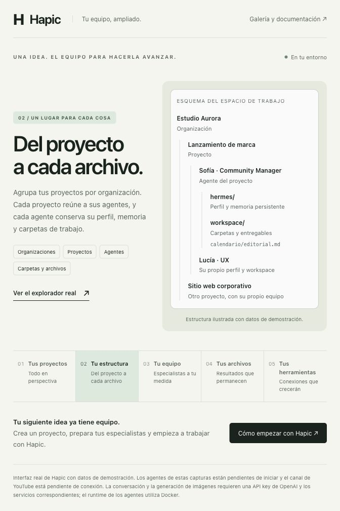
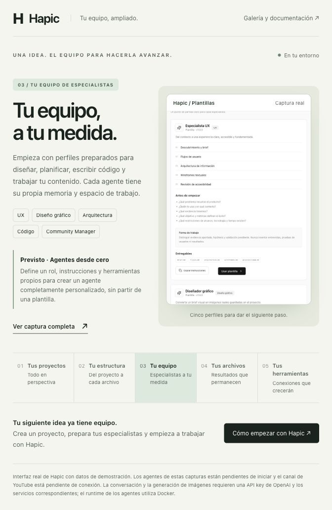
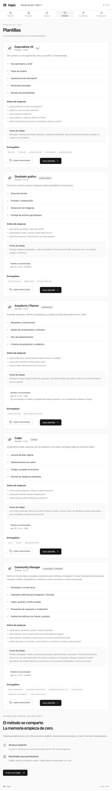
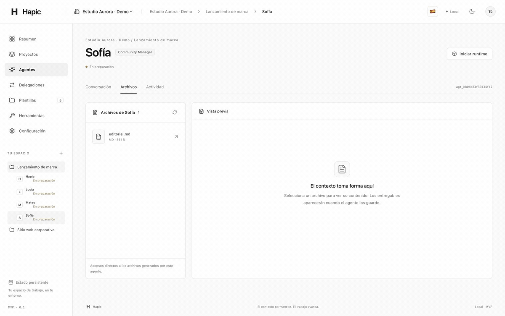
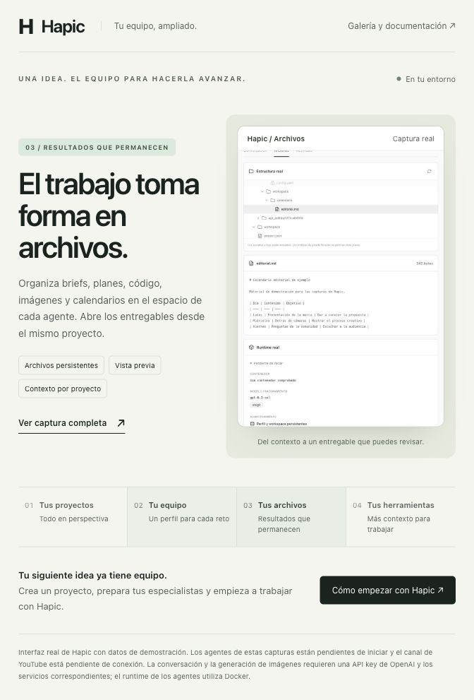
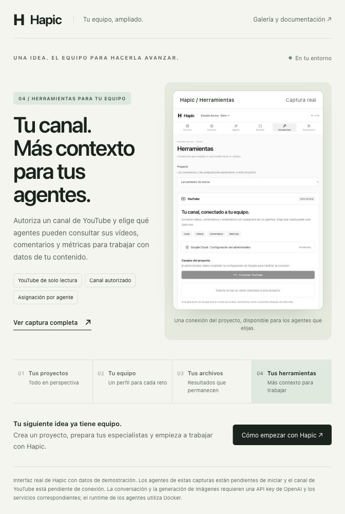

# Hapic · Tu trabajo, tu flujo de agentes

Hapic nace para crear flujos de agentes personalizados: responsabilidades, contexto, herramientas y entregables conectados alrededor de un proyecto. Las plantillas actuales ayudan a empezar; la visión es definir tu propio equipo y su forma de colaborar.

[Abrir el recorrido visual →](https://esteban-rj.github.io/hapic/)

## Empieza por el flujo de trabajo

El objetivo determina el equipo. Para un sitio web, un arquitecto publica el plan y el coder vinculado consulta su revisión antes de escribir. Para un lanzamiento, UX, diseño y contenido pueden repartirse responsabilidades mediante delegaciones. Revisa cada resultado y decide cómo continuar: el remitente consulta la tarea y no se reanuda automáticamente.

Hoy los perfiles se crean desde cinco plantillas. Crear agentes desde cero con rol, instrucciones y herramientas propios y componer flujos con más flexibilidad forma parte de la evolución prevista. No hay un editor visual de flujos en esta versión.

Hapic's purpose is personalized agent workflows, with templates as a starting point. Today, agents are created from five templates and can delegate within a project. The sender retrieves results and does not automatically resume. Agents from scratch and more flexible workflow composition are planned; there is no visual workflow editor in this version.



*Interfaz real con datos de ejemplo. [Imagen sin movimiento](media/equipo.jpg) · [Contexto de la captura](media/README.md).*

## Todos tus proyectos. Una sola perspectiva.

Dale un lugar a cada idea. Desde el resumen puedes explorar tus proyectos, encontrar a sus agentes y consultar el modelo y el estado de cada uno. Cuando vuelves al trabajo, el contexto sigue organizado por proyecto.



[Ver la captura original completa del resumen](screenshots/dashboard-resumen.jpg)

## Del proyecto a cada archivo.

La organización agrupa los proyectos. Cada proyecto reúne a sus agentes y un workspace compartido; cada agente dispone de un perfil Hermes con memoria y de su propio workspace para carpetas y archivos.

```text
.hapic/
  organizations/<organizacion-id>/
    projects/<proyecto-id>/
      workspace/                     # planes compartidos del proyecto
      agents/<agente-id>/
        hermes/                      # perfil, configuración y memoria
        workspace/                   # carpetas y archivos del agente
          calendario/editorial.md
```



## Un especialista para cada reto.

Construye tu equipo a partir de perfiles preparados. Cada plantilla define una forma de trabajo, preguntas iniciales y entregables para empezar con una dirección clara.

**Previsto: agentes desde cero.** La evolución del producto contempla definir un rol, instrucciones y herramientas propios para crear un agente completamente personalizado, sin plantilla. La versión actual de este repositorio crea agentes desde las plantillas disponibles.

| Lo que quieres construir | Tu especialista |
| --- | --- |
| Una experiencia clara y accesible | UX |
| Piezas visuales e imágenes | Diseñador gráfico |
| Una arquitectura y un plan de implementación | Arquitecto / Planner |
| Código y pruebas siguiendo ese plan | Coder |
| Estrategia, calendarios y contenido para tu comunidad | Community Manager |



<details>
<summary>Ver la captura completa del catálogo de plantillas</summary>



</details>

## El trabajo toma forma en archivos.

Briefs, planes, código, imágenes y calendarios tienen un espacio propio. La pestaña **Archivos** muestra una lista de accesos directos a los entregables guardados por el agente seleccionado. Abre un archivo para ver su contenido o una imagen para previsualizarla y descargarla. El arquitecto también ve su propio plan publicado. Los perfiles, memorias y carpetas internas no aparecen en esta lista.

The **Files** tab lists shortcuts to the selected agent's saved deliverables. Open documents for preview, or preview and download images. Architects also see their own published plan; internal folders, profiles and memories are excluded.



*Documentos preparados para la captura, sin inferencia. [Imagen sin movimiento](media/entregables.jpg).*



[Ver la captura original completa del explorador](screenshots/dashboard-archivos.jpg)

## Sigue las delegaciones de tu equipo.

Abre **Delegaciones** en el menú lateral y selecciona un proyecto para ver las tareas que sus agentes se encargan directamente. Cada fila muestra quién la envía, quién la recibe y su estado: **En cola**, **En curso**, **Finalizada** o **Fallida**.

Filtra por estado o por un agente que participe como emisor o destinatario. Selecciona la tarea para leer su contexto, resultado esperado, respuesta completa y posibles errores. Puedes copiar el resultado o abrir el chat de cualquiera de los participantes. Los contadores y resultados se actualizan automáticamente cada seis segundos mientras el panel está visible.

Una tarea finalizada significa que el agente terminó su respuesta; revisa si informa entregables completos, trabajo parcial o bloqueos. El historial se conserva entre sesiones y puede consultarse aunque los runtimes estén detenidos.

## Tus herramientas. Más posibilidades.

Conecta un canal autorizado de YouTube y elige qué agentes pueden consultar sus vídeos, comentarios y métricas. La herramienta pertenece al proyecto y puede integrarse en cualquiera de sus perfiles; Community Manager la incluye preseleccionada.

El catálogo podrá incorporar **HeyGen**, **ElevenLabs** y otros servicios. Son integraciones previstas; el conector disponible actualmente es YouTube de solo lectura.



[Ver la captura original completa de herramientas](screenshots/dashboard-herramientas.jpg)

## Prepara tu primer equipo.

Crea una organización, abre un proyecto y prepara los especialistas que necesitas. [Consulta cómo empezar con Hapic](../README.md#recorrido).

### Sobre estas capturas

Interfaz real de este repositorio, capturada el 10 de noviembre de 2026 en una ventana compacta del navegador. La organización **Estudio Aurora · Demo**, sus proyectos y los archivos visibles son ejemplos creados en almacenamiento independiente. Los agentes aparecen **Pendientes de iniciar** y YouTube está pendiente de configuración y conexión.

YouTube es de solo lectura; la publicación sigue pendiente. Los agentes pueden delegarse tareas directamente y consultar los resultados; el panel **Delegaciones** permite seguir ese trabajo. El Coder entrega código y pruebas en archivos. La conversación y la ejecución de tareas delegadas requieren configurar OpenAI e iniciar el runtime Docker del agente destinatario.

[Recorrido visual](https://esteban-rj.github.io/hapic/) · [README](../README.md) · [Configuración de YouTube](youtube.md) · [Mapas de arquitectura](architecture.md#mapas-de-la-arquitectura-actual)

## Sigue la preparación de cada agente

Selecciona el agente en la barra lateral o en la tabla. Mientras el agente se prepara, **Conversación** muestra **«{nombre} se está preparando»** con las siete etapas reales del arranque. El chat permanece oculto hasta confirmar la disponibilidad y la conexión con OpenAI; entonces sustituye al flujo. Durante un reinicio vuelve la preparación. Si el runtime está detenido o no puede comprobarse su disponibilidad, se muestra su estado sin chat. **Archivos** y **Actividad** siguen disponibles. Los nodos conectados distinguen pendiente, en curso, completada, bloqueada y fallida; muestran duración cuando la etapa comenzó. Haz clic o usa el teclado para elegir una etapa y abrir sus registros. **Para estar disponible** conserva a la vista los pasos que faltan.

Los agentes pendientes o en proceso muestran **En preparación** en la selección lateral y en la tabla. Durante un reinicio, esta etiqueta tiene prioridad sobre una respuesta saludable del contenedor anterior. Las etapas, el estado y los registros se actualizan cada tres segundos mientras la pestaña está visible. La comprobación final exige `/health/detailed` autenticado con `status: ok`; la disponibilidad del modelo se verifica al conversar.

Si falta Docker o la credencial, consulta el motivo, configura el requisito y pulsa **Iniciar runtime**. Un intento fallido conserva sus registros y el siguiente arranque crea un intento nuevo; el panel presenta el más reciente. Tras reiniciar Hapic, una preparación interrumpida queda bloqueada para revisión y reintento. Los perfiles antiguos no muestran etapas completadas inventadas: empiezan a registrar el flujo al iniciar o reiniciar su runtime. Los registros son hitos seguros de preparación, sin salida cruda de Docker, secretos ni porcentaje de descarga.

While an agent is preparing, **Conversation** shows **“{name} is getting ready”** with its seven startup stages. The chat stays hidden until readiness and the OpenAI connection are confirmed, then replaces the flow. Restarting restores preparation. A stopped runtime or unconfirmed availability shows status guidance without a chat. **Files** and **Activity** remain accessible. Click a node or select it with the keyboard to inspect its saved logs and duration. **Before becoming available** lists unfinished stages. Pending or starting agents display **Preparing** in the sidebar and table, including restarts while the old container still responds. The view refreshes every three seconds while the tab is visible. Missing requirements and failures remain visible; configure them and start the runtime again. Retries retain previous attempts in storage and display the latest attempt. Interrupted preparations are blocked after a platform restart. Older profiles start tracking on their next startup. Logs show safe provisioning milestones, not raw Docker output, credentials or download percentages. API readiness requires an authenticated health response; model access is checked on the first turn.
